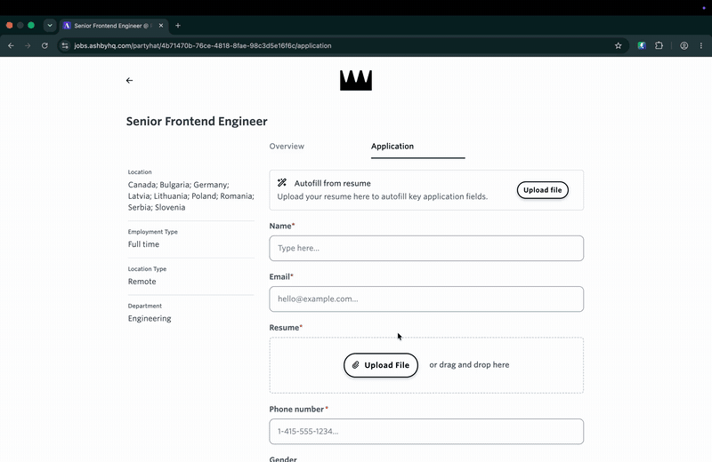

# ⚡ Job Form Filler

Fill job application forms (Ashby, Greenhouse, Lever, Workable, LinkedIn Easy Apply, Djinni and others) from your own local profile, in any language. Optionally let your AI assistant (Claude Code, Claude Desktop) answer only the custom questions.

🇺🇦 [Документація українською](README.uk.md)

[](docs/demo.mp4)
<sub>Click the preview to watch the 25-second demo with voiceover.</sub>

**Why it exists:** handing a raw DOM or screenshots to an AI for every form burns tokens. Job Form Filler splits fields into tiers:

1. **Tier 1, 0 tokens:** name, contacts, links, work authorization, notice period, EEO, resume file. Filled locally from your profile.
2. **Tier 2, minimal tokens:** the AI gets only the unfilled questions plus a compact job summary.
3. **Tier 3, you:** motivation and behavioural questions are never written by AI. They come back to you.

The final **Submit button is never clicked automatically.** You review and send.

## Install

### Option A: extension only (most people)

1. Install **Job Form Filler** from the [Chrome Web Store](https://chromewebstore.google.com/detail/job-form-filler/mldoeaodmjbjmkpnchkhaahpaphoffei). Or from source: `chrome://extensions` → Developer mode → Load unpacked → pick the `extension/` folder.
2. Open the popup → **Profile** tab → fill in your data and upload your resume (PDF/DOCX, up to 5 MB).
3. Open an application form → **Fill standard fields**.

Your profile and resume stay in `chrome.storage.local`. Nothing is sent anywhere.

### Option B: add an AI assistant (optional)

The MCP server lets Claude read the form, answer custom questions from your resume, and fill them in.

**Claude Desktop (one click):** download `job-form-filler-<version>.mcpb` from the [latest MCP release](https://github.com/MIt9/job-form-filler/releases/tag/mcp-v1.2.1) and double-click it. No Node.js install or config editing needed. You can optionally pick a folder with role-specific resumes in the extension settings.

Claude Desktop asks for approval on every tool call by default. In the extension's settings you can safely switch the read-only tools (`Get active job form`, `Get form state`, `Get candidate profile`) and `Autofill static fields` to "Always allow". There is no submit tool: you always press Submit yourself.

**Claude Code:**
```bash
claude mcp add job-form-filler -- npx -y job-form-filler
```

**Other MCP clients**, add to the MCP config:
```json
{
  "mcpServers": {
    "job-form-filler": { "command": "npx", "args": ["-y", "job-form-filler"] }
  }
}
```

Requires Node.js 18+ (not for the Claude Desktop bundle). The popup's **Settings** tab shows whether the bridge is connected.

### Optional environment variables

| Variable | Purpose |
|---|---|
| `RESUME_REPO_PATH` | Folder with role-specific resumes (`<repo>/resume/<role>/*.md, *.pdf` or `<repo>/<role>/...`). Enables role variants, PDF upload and saving applications. Off by default. |
| `BRIDGE_PORT` | Bridge port, default `8765`. |
| `JFF_DATA_DIR` | Where saved answers live, default `~/.job-form-filler`. |
| `JFF_EXTENSION_IDS` | Extra extension IDs the bridge accepts (comma-separated). The Chrome Web Store build is always allowed; add the ID of a "Load unpacked" build here. |
| `JFF_ALLOW_ANY_EXTENSION` | Set to `1` to accept any extension. Local development only. |

Env vars go into the `env` block of your MCP config, e.g. `"env": { "RESUME_REPO_PATH": "/path/to/resumes" }`.

Several MCP clients (Claude Desktop, Claude Code) share one bridge: the first one started owns the port and its settings apply, so give them all the same `RESUME_REPO_PATH`. When the owner quits, the next tool call from another client takes the port over.

## Permissions

The extension asks only for the ATS domains above plus `localhost` for the optional bridge. **Work on any website** (Settings tab) is an opt-in extra permission for custom company career pages. See [docs/PRIVACY.md](docs/PRIVACY.md).

## Develop

```bash
git clone https://github.com/MIt9/job-form-filler && cd job-form-filler
npm install
npm test
npm run bridge   # http://127.0.0.1:8765
```

More detail (profile format, MCP tools, workflow, safety model) in [README.uk.md](README.uk.md).

## License

MIT
